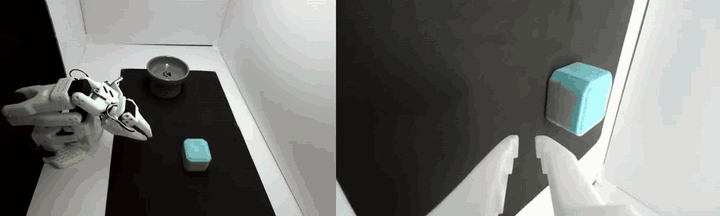

# so101-policy

M3 of the [SO-101 series](https://github.com/hujunhan/so101-core). It teaches the arm one manipulation task from
teleoperated demonstrations and measures how well learned policies do it:

- **One task**, chosen so success is unambiguous and the scene can be reset quickly.
- **50-100 teleoperated demonstrations** with the leader arm, recorded through LeRobot (ZED 2 scene view and
  wrist camera).
- **ACT, then a fine-tuned SmolVLA** (pi0.5 as a stretch).
- **A pre-registered evaluation protocol**: the trials, the success criterion and the analysis fixed before
  any policy is run; success rates with confidence intervals and a failure taxonomy.

Deliverable: a video, a results table and a failure analysis.

> **Status (2026-11-10):** S1 and S2 done; the light box is built and PROTOCOL section 7 is complete (a blue
> ring box into a grey bowl, amendments 1-3). S3 under way: 20 demonstrations recorded; a pilot ACT policy
> trained on them picks and places the box on the arm in part of the region (below). Next: about 30 more
> demonstrations, mostly near the arm, then train ACT on all of them and run the evaluation (S5).

## What M2 hands over

From [so101-calib](https://github.com/hujunhan/so101-calib) (README, "Handed to M3 and M5"):

- **Calibration in hand**: the elbow's zero offset (7.3 deg) is in so101-core's joint map; LeRobot's own
  calibration and recordings are unchanged. `results/s4/handeye.yaml` has the wrist camera on the gripper and
  the ZED in the base frame; `results/s1/servo_model.json` the servos' static model.
- **The ZED pose is tied to the current setup.** The workspace is being rebuilt (light box, backdrop); after
  that the ZED has to be located again with a short hand-eye re-run (not written yet).
- **The ZED sees ~100 deg**, mostly room: plan FHD per eye and a fixed crop around the workspace. The background
  behind the arm stays visible in any light box: keep it constant between training and evaluation, keep people
  and animals out of view during evaluation.
- **Accuracy**: near the calibrated region ~1-2 mm per error term; far poses several mm off (cause open).
  Learned policies close the loop through the cameras, so this matters less here than for M5.

## Plan

| Session | Content | Output |
|---|---|---|
| **S1** | Choose the task and write the evaluation protocol (success criterion, trial count, initial-state distribution, analysis) before any data | `docs/PROTOCOL.md`, DECISIONS |
| **S2** | Recording pipeline: LeRobot record with the leader arm, ZED (FHD, cropped) and wrist camera; a few dry-run episodes; replay and check | Pipeline, a test dataset |
| **S3** | Collect 50-100 demonstrations in the final environment | Dataset (Hugging Face Hub or local) |
| **S4** | Train ACT on the laptop GPU; offline checks (loss, action replay) | Checkpoint, training report |
| **S5** | Evaluate ACT by the protocol | Success rate with CI, failure taxonomy |
| **S6** | Fine-tune SmolVLA; evaluate by the same protocol | Comparison table |
| **S7** | Write-up: README, `docs/DESIGN.md`, `docs/THEORY.md`, video | |

S1, S2 and S4 (on a public dataset) can start before the environment is rebuilt; S3 and the evaluations need
the final environment, because policies are sensitive to background and lighting.

## S4 dry run on a public dataset (2026-11-08)

ACT (LeRobot defaults: chunk 100, ResNet18, CVAE) on `lerobot/svla_so101_pickplace` (50 SO-101 pick-and-place
episodes, two 640 x 480 cameras), the last 5 episodes held out. Batch 8, bf16 mixed precision, 30k steps
(~23 epochs): 1 h 54 min on the RTX 3080 Laptop, 0.22 s per step (0.29 s in fp32), 3.6 GB of GPU memory;
data loading is not the bottleneck (0.003 s per step).

- **Training loss keeps falling** (L1 0.28 at 2k steps, 0.09 at 30k); **the held-out loss is flat from 2k
  steps on** (0.36 -> 0.34). With 45 demonstrations most of what the later steps learn does not carry over to
  new episodes. (The two are not directly comparable: training uses the CVAE's latent from the true actions,
  held-out uses the zero latent as at deployment.)
- **Open-loop action error on the held-out episodes** (`so101-offline-eval`; mean over the actions a deployed
  policy would execute, deg; gripper %), against "hold still" (predict the current state):

  | Checkpoint | pan | lift | elbow | wrist flex | wrist roll | gripper |
  |---|---:|---:|---:|---:|---:|---:|
  | hold still | 51.4 | 25.3 | 21.5 | 10.2 | 22.7 | 9.4 |
  | 10k steps | 28.2 | 15.6 | 11.5 | 6.9 | 11.4 | 4.7 |
  | 20k steps | 24.4 | 12.5 | 10.4 | 6.4 | 9.6 | 3.9 |
  | 30k steps | 26.0 | 12.4 | 10.1 | 6.3 | 9.8 | 3.8 |

  10k -> 20k helps by 10-20 %; 20k -> 30k does not (within the noise of 5 episodes). The predicted motion has
  the right shape (reach, grasp, lift, place, return), and much of the remaining error is **timing**: the
  policy starts about 1 s before a demonstrator who waited 2 s. Open-loop error is a check of training, not of
  task success: on the arm the policy reacts to what it sees.
- For our recordings: start moving soon after "Recording episode" and stop soon after returning, so the
  demonstrations do not teach a random wait.

### SmolVLA on the same data (2026-11-08)

SmolVLA (`lerobot/smolvla_base`, 450M parameters; the vision-language model frozen, the 100M action expert
trained; chunk 50) fine-tuned with the same LeRobot pin as ACT (the `smolvla` extra; no newer LeRobot needed).
The two cameras are renamed to the base model's `camera1` (up) and `camera2` (side), with one empty camera.

- **Speed**: ~17 samples/s at any batch size (half of ACT); batch 8 uses 3.4 GB, 32 uses 9.8 GB, 64 runs out
  of memory. The common recipe (batch 64, 20k steps) would take ~21 h here; this run: batch 32, 6000 steps
  (~18 epochs), 3 h 11 min.
- **Held-out loss** (flow matching; not comparable with ACT's L1) is lowest at 2k steps (0.24) and rises to
  0.30 at 6k while the training loss keeps falling (0.13 -> 0.08): overfitting by this measure.
- **Open-loop action error** on the same held-out episodes, by how far ahead the action is (deg; gripper %).
  SmolVLA executes 50 actions per chunk and ACT 100, so the "executed" numbers are not comparable; per horizon
  they are:

  | Ahead | Policy | pan | lift | elbow | wrist flex | wrist roll | gripper |
  |---|---|---:|---:|---:|---:|---:|---:|
  | 10 frames | ACT 20k | 8.0 | 6.0 | 4.5 | 4.4 | 3.7 | 2.2 |
  | | SmolVLA 4k | 6.5 | 4.8 | 4.0 | 3.7 | 2.8 | 1.7 |
  | 25 frames | ACT 20k | 14.4 | 9.0 | 6.9 | 5.4 | 6.3 | 2.7 |
  | | SmolVLA 4k | 15.7 | 7.9 | 6.5 | 5.5 | 6.9 | 2.7 |
  | 50 frames | ACT 20k | 20.8 | 13.0 | 9.7 | 7.1 | 9.3 | 4.0 |
  | | SmolVLA 4k | 18.4 | 14.4 | 11.1 | 7.1 | 9.8 | 4.3 |

  About the same as ACT; 2k, 4k and 6k steps differ by less than the noise of 5 episodes beyond 10 frames
  ahead, although the held-out loss rose. Offline numbers cannot rank the two: S5/S6 on the arm will.
- **Inference** (RTX 3080 Laptop, our image sizes): a new SmolVLA chunk takes 190 ms (10 flow-matching
  steps), ACT 32 ms; the other ticks take 6-8 ms. At 30 Hz a synchronous SmolVLA loop stalls ~6 ticks every
  50 (the arm holds its last command for 0.2 s every 1.7 s). Options for S6: LeRobot's asynchronous inference
  (compute the next chunk while the current one runs), fewer flow-matching steps, or accept the pause.

## First demonstrations and a pilot policy (2026-11-10)

*Pilot ACT policy (20 demonstrations), real time, ZED view (as the policy sees it) and wrist camera. The
operator had put the box back on the table after the policy's first success; it picks it up again.
[MP4](docs/media/pilot_act20_success.mp4).*

**Demonstrations (S3, first 20).** The blue ring box (55 x 50 x 40 mm) into the grey bowl, recorded with the
leader arm in the light box (`so101-record --display`): 10 episodes take about 4 min 40 s including resets,
17-35 s each. All 20 end with the box in the bowl; 29.8 Hz control, every video frame present. The box
positions (located in the first ZED frame of each episode) cover the far two thirds of the region but only one
episode is in the third nearest the arm; the next batch fills that.

**Pilot policy.** ACT on 18 episodes (2 held out), batch 8, bf16, 20k steps: 1 h 23 min, 0.25 s per step,
4.1 GB. On the held-out episodes the open-loop action error stops improving after 5k steps (18 demonstrations
are learned quickly); the shoulder, elbow and gripper are about half the hold-still baseline, the wrist roll
is worse than holding still: the demonstrator rolls the wrist to match the box's yaw, and 18 episodes do not
teach that yet.

**Pilot runs on the arm** (`so101-rollout`; not evaluation trials, not on the listed states):

| Run | What happened |
|---|---|
| 1, 2 | Stopped after 0.6 s: the protocol's start pose had the wrist rolled 100 deg off the demonstrations' (taken from a rest pose stored in M0); the policy first rolled it back at the 120 deg/s cap and the stall check (15 deg) fired. Fixed: start pose = the demonstrations' start (PROTOCOL amendment 3), stall threshold 25 deg at this cap. |
| 3 | Reached the box repeatedly and closed the gripper beside it, pushing it around; no grasp in 31 s, stopped by the operator. |
| 4 | Picked the box and put it in the bowl (by ~20 s), returned to the start pose and waited. The operator put the box back on the table; the policy picked it again and placed it (the clip above), and was reaching for it a third time at the 70 s limit. |

What it shows: the whole chain (cameras, policy, safety layer, start pose) works, and 20 demonstrations are
enough for some successes in the area they cover; grasping is not yet reliable. Next: about 30 more
demonstrations, most of them in the near third of the region and with varied box yaw.

**Two observations from the videos.**
- *Green lines*: 0.5 % of the ZED frames in the dataset (63 of 12 313) have a one- or two-pixel green line
  across the image, a corrupted row from the UVC stream (3840 x 1080 YUYV at 30 fps is about 250 MB/s on USB 3).
  Too rare and thin to matter for training; if it gets worse, give the ZED its own USB 3 port without a hub.
- *Shake*: the operator sees the box and the camera move when the arm moves fast. In the pilot-4 video a
  static patch of the back wall moves 0.13 px (median) and 0.32 px (95th percentile) against the first frame
  in the 840 x 540 image, under a millimetre on the table: no concern for the policy. Stiffening the camera
  mount would still help any later calibration.

## Hardware

- The SO-101 follower and leader, as in M0-M2 (device paths in so101-core's git-ignored `config/devices.yaml`).
- ZED 2 on a fixed mount, read as a UVC stereo camera (factory calibration); wrist camera on the gripper (USB,
  1280 x 720 MJPG, fixed focus).
- Linux laptop with an RTX 3080 Laptop GPU (16 GB).
- Workspace (2026-11-09): a white foam-board light box on an IKEA SANDSBERG table (3D-printed three-way corner
  joints), a black fabric mat under the working region (taped down), the left side screened. One light: an
  Ulanzi UA12 bi-colour LED tube (2700-6500 K, CRI > 95) on its magnetic mount at the centre, at 10 % brightness.
  No flicker or banding in either camera at that setting (frame brightness varies 0.04 % over 3 s).

## Decisions

See [DECISIONS.md](DECISIONS.md).
