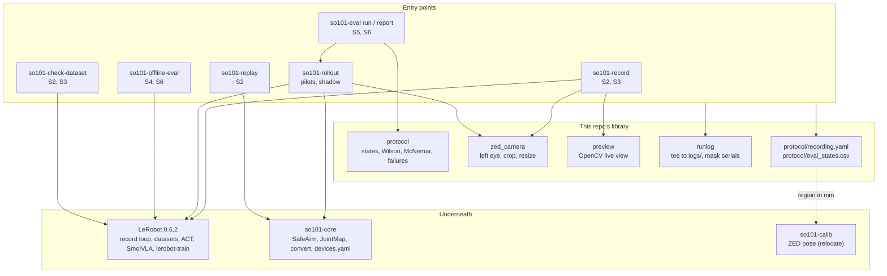
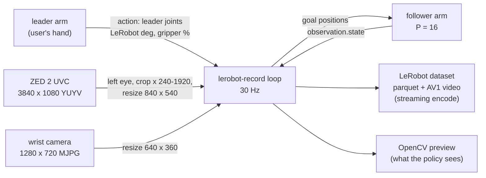
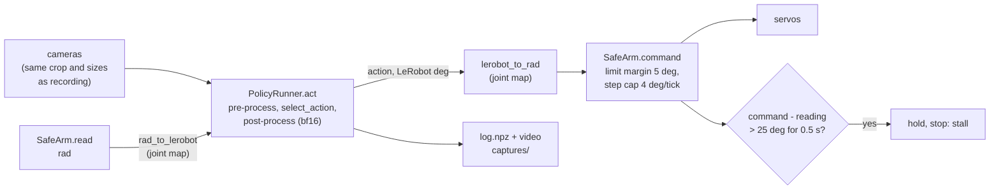
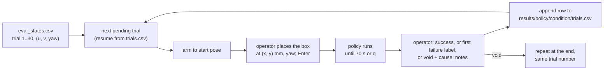

# so101-policy design

Why this package looks the way it does, how its parts fit together, and which parts matter most. State as of
2026-11-17, during S3 (20 demonstrations, a pilot ACT policy; no evaluation trial run yet). Results are in the
[README](../README.md); the theory behind each method is in [THEORY.md](THEORY.md); the evaluation rules are
in [PROTOCOL.md](PROTOCOL.md); the decision log, with dates and the options weighed, is
[DECISIONS.md](../DECISIONS.md).

## 1. What it is for

M3 of the SO-101 series. It sits on [so101-core](https://github.com/hujunhan/so101-core) (M0: robot model,
units, joint map, `SafeArm`) and uses one result of [so101-calib](https://github.com/hujunhan/so101-calib)
(M2: the ZED located in the arm's base frame, to define the task region in millimetres). It answers:

1. **Can a low-cost arm learn one pick-and-place task from ~50 teleoperated demonstrations?** (S2: recording
   pipeline; S3: demonstrations; S4: training.)
2. **How well, measured honestly?** A pre-registered protocol (S1): 30 seeded trials, a fixed success
   criterion, Wilson intervals, a failure taxonomy (S5).
3. **Does a pretrained vision-language-action model do better than ACT trained from scratch?** (S6: SmolVLA on
   the same data, the same trials, a paired test.)

It deliberately does **not** write its own learning code: training and the policies are LeRobot's. What this
repo owns is everything around them that decides whether a result can be trusted: the scene and camera
settings, the recording wrapper, dataset checks, safe execution on the arm, and the evaluation.

M4 (camera robustness) and M5 (classical pipeline) reuse the protocol, the trial list, the rollout loop and
the evaluation runner unchanged.

## 2. Design goals

| Goal | What it means in the code |
|---|---|
| **Fix the rules before the data** | `docs/PROTOCOL.md` and `protocol/eval_states.csv` (seed 20261108) were committed before the first demonstration; changes are dated amendments. A test checks the list against the seed. |
| **Train and evaluate in the same world** | One committed settings file (`protocol/recording.yaml`: cameras, crop, sizes, V4L2 controls, servo gain, start pose, step cap, time limit) is read by recording, rollout and evaluation. Nothing is typed by hand. |
| **Standard data, standard learners** | Datasets are LeRobot v3; ACT and SmolVLA train with `lerobot-train` without conversion. Our code wraps LeRobot, it does not fork it. |
| **Hardware only through safe paths** | Demonstrations: LeRobot's teleoperation loop with the user at the leader. Policies and replays: so101-core's `SafeArm` (limit margin, step cap, stall stop), after a `yes`. |
| **Check every link without the arm first** | `--shadow` runs a policy on live cameras with the arm limp; `so101-offline-eval` runs it on recorded episodes; `so101-check-dataset` checks every episode; protocol and statistics are unit-tested. |
| **Leave a trace Claude can read** | Every command tees its terminal output to `logs/` (serials masked); rollouts and trials save video, states, actions and per-tick timing to `captures/`. |
| **Public repo** | Datasets, videos and contact sheets (they can show the room) stay in git-ignored `data/`, `captures/`; only reviewed, cropped media go to `docs/media/`. Serial numbers are masked in logs. |

## 3. Architecture

### 3.1 Layers

Two paths move the arm and they are kept apart on purpose:

- **Teleoperation** (`so101-record`) is LeRobot's own loop: the follower copies the leader at 30 Hz, with
  LeRobot's 10 deg relative-target cap. The user's hand is the controller and is at the arm.
- **Autonomous motion** (`so101-replay`, `so101-rollout`, `so101-eval`) goes only through `SafeArm`: every
  command is clipped to the joint limits minus 5 deg, capped per tick, and a stall watch stops the run.

### 3.2 What each session reads and writes

| Session | Command | Reads | Writes |
|---|---|---|---|
| S1 | `python -m so101_policy.protocol` | the seed | `protocol/eval_states.csv` (never changes) |
| S2, S3 | `so101-record` | `devices.yaml`, `recording.yaml`, leader + follower, cameras | `data/<repo_id>/` (LeRobot v3: parquet + AV1 video), `logs/` |
| S2, S3 | `so101-check-dataset` | a dataset | report (terminal, `logs/`); `--sheet`: contact sheet in `captures/` |
| S2 | `so101-replay` | one episode, the arm | replay log in `captures/` |
| S4, S6 | `lerobot-train` (LeRobot's) | a dataset | `outputs/train/<run>/checkpoints/` (git-ignored), `logs/` |
| S4, S6 | `so101-offline-eval` | a checkpoint, held-out episodes | per-joint error table, plots |
| pilots | `so101-rollout [--shadow]` | a checkpoint, cameras, the arm | `captures/rollout/<name>/` (video, `log.npz`) |
| S5, S6 | `so101-eval run` | a checkpoint, `eval_states.csv`, `recording.yaml` | `results/<policy>/<condition>/trials.csv` (committed), `captures/eval/` |
| S5, S6 | `so101-eval report` | one or two trial logs | rates with Wilson intervals; McNemar for two |

## 4. Data flow

### 4.1 Recording: from the leader to a dataset

Before LeRobot starts, `so101-record`:

1. reads the device paths from so101-core and the settings from `recording.yaml`;
2. applies the cameras' V4L2 controls (60 Hz power line, no dynamic frame rate) and reads them back;
3. registers the `zed` and resized-camera types (LeRobot's OpenCV camera has no crop);
4. checks that the leader is close to the follower's pose (else the follower would jump at the first tick)
   and sets the follower's goal to its present position (the M0 stale-goal pitfall);
5. builds the full `lerobot-record` command line and runs it, with our preview replacing rerun (which hung
   on this laptop's hybrid GPU).

**The action is the leader's position, the state is the follower's.** The policy learns to output what the
demonstrator commanded, not where the follower ended up; the follower lags the leader by a few frames and sags
under gravity, and `so101-check-dataset` measures both (best lag and remaining error per episode).

### 4.2 Training

`lerobot-train` on the local dataset (DECISIONS 2026-11-09: datasets stay local). The recipe used so far (to be
recorded in DECISIONS when the full-data run is made): ACT with LeRobot's defaults (ResNet18 from ImageNet,
chunk 100, CVAE), batch 8, bf16 mixed precision, 20k steps, `eval_split 0.1` (episodes held out for the
offline check). SmolVLA from `lerobot/smolvla_base`, the vision-language model frozen, the action expert
trained, batch 32. Image augmentation is off in the pilot (LeRobot's default); turning it on is proposed for
the full run (section 9).

### 4.3 Running a policy on the arm

Per 30 Hz tick: the newest frame of each camera (rejected if older than 0.5 s), the joint reading converted to
LeRobot units, one action from the policy (LeRobot's ACT and SmolVLA keep their own queue of the current
chunk and only run the network when it is empty), the action converted back to radians and sent through
`SafeArm`. The two conversions use the same joint map, so the policy sees exactly the units it was trained on;
the joint map's elbow offset matters only for `SafeArm`'s limits.

Before a live run the arm moves to the protocol's start pose at 20 deg/s. A `q` key listener is active only
while the policy runs (LeRobot's listener swallowed the typed `yes`). `--shadow` keeps the arm limp, runs the
policy on the live cameras and logs the actions it would have sent.

### 4.4 Evaluation

A row is written as soon as a trial is judged, so a session can stop at any trial and resume. `report` reads
the final row per trial (a repeated void replaces its void), prints n, successes, the Wilson interval, voids,
the median time to success and the failure counts, and for two policies the paired McNemar test.

## 5. Key pieces

### 5.1 The settings file (`protocol/recording.yaml`)

One file holds everything the protocol says must be the same in training and evaluation: camera capture
modes, the ZED crop, output sizes, V4L2 controls, the servo gain, the evaluation region, bowl, start pose and
time limit, and the rollout step cap. Recording, rollout and evaluation all read it; a change is a commit with a
reason. This is what makes "same settings as in the demonstrations" checkable rather than remembered.

### 5.2 The ZED as a LeRobot camera (`zed_camera.py`)

The ZED 2 over UVC delivers both eyes side by side (3840 x 1080 at FHD, YUYV only). `ZedCamera` subclasses
LeRobot's `OpenCVCamera`: it captures the full frame, keeps the left eye, crops x 240-1920 (the dark strip
outside the box goes) and resizes to 840 x 540. It reports the output size as its own, so the dataset's
features are right. `ResizedCamera` does the same for the wrist camera: captured at 1280 x 720 (the field of
view M2 calibrated), stored at 640 x 360, which halves ACT's training time (DECISIONS 2026-11-09).

### 5.3 The protocol in code (`protocol.py`)

`initial_states` draws the 30 states in normalized region coordinates with the fixed seed, so the list could
be committed before the region was known; `wilson` and `mcnemar_exact` are the two statistics; `FAILURES` is
the taxonomy. Tests pin the list to the seed and check the statistics against known values.

### 5.4 Offline evaluation (`offline_eval.py`)

Runs a checkpoint over held-out episodes open loop: at each frame the policy sees the recorded observation
and predicts a chunk; the error is measured against what the demonstrator did, per joint and by horizon, and
against a "hold still" baseline. It checks training and the data pipeline; it does not predict success on the
arm (THEORY section 7).

### 5.5 The rollout loop (`rollout.py`)

`PolicyRunner` loads any LeRobot checkpoint with its pre- and post-processors, maps our camera names to the
policy's (`--camera-map`, for policies trained on other datasets) and reads the training task string.
`run_episode` is the tick loop of section 4.3; `VideoSink` writes the camera streams in a background thread so
the loop does not wait on encoding. The stall threshold (25 deg for 0.5 s) is set from the pilot runs: at the
4 deg/tick cap a freely moving joint reads 12-16 deg behind its command (THEORY section 9).

### 5.6 Dataset checks (`check_dataset.py`)

Per episode: length, video frames against data frames, still time at the start and end, start and end pose,
the largest one-frame action jump, the follower's lag behind the leader and the remaining error. These catch
the faults that silently damage training: dropped frames, a teleoperation glitch, an episode that starts with
a long wait (THEORY section 6).

## 6. Design decisions and rejected alternatives

| Decision | Why | Rejected |
|---|---|---|
| Pre-registered protocol, 30 seeded trials, same list for every policy | paired comparisons; no tuning on the test; the time limit fixed by rule before any policy ran | a regular grid; 20 or 50 trials; a time limit chosen after seeing policies |
| Wilson interval, exact McNemar | correct at small n and rates near 0 or 1; the paired test uses only the trials where policies disagree | Wald interval; unpaired two-proportion test |
| Final checkpoint by rule | choosing a checkpoint on the evaluation list overstates success | best checkpoint on the trials |
| Record through a wrapper around `lerobot-record` | standard dataset; one settings file; crop and start checks without forking LeRobot | plain `lerobot-record`; own record loop through `SafeArm` |
| Policy runs through `SafeArm`, not LeRobot's record loop | limit margin, step cap and stall stop for a controller nobody holds | `lerobot-record --policy` (only the 10 deg relative cap) |
| Two cameras: ZED left eye cropped + wrist | scene view says where to go, wrist view says how to grasp; the common SO-101 recipe | either camera alone; the right eye (cuts off the folded arm) |
| ZED 840 x 540, wrist 640 x 360 | 0.25 s per ACT step against 0.53 s with the wrist at 1280 x 720; the box still spans 52-64 px | full-resolution images (do not fit in 16 GB) |
| ZED automatic exposure kept | the light box keeps the light constant; locking needs vendor extension-unit commands | port zed-open-capture's exposure control; the ZED SDK |
| Servo P = 16 | the pipeline was verified at 16; public datasets use it; the policy closes the loop through the cameras | 32 (M2's value: half the sag, more jitter and heat) |
| Start pose = the demonstrations' median first frame, clipped to limits | a policy starts where its data start (amendment 3) | so101-core's stored rest pose (wrist rolled 100 deg off) |
| Step cap 4 deg/tick (120 deg/s) | above the demonstrations' peak (~110 deg/s), so the cap does not slow the policy below what it learned | 2 deg (60 deg/s); 10 deg (no real limit) |
| Datasets local | training reads local files; the videos need a privacy review before publishing | Hugging Face Hub, private or public |
| One object, a fixed bowl | unambiguous success, one-object reset, comparable with M5's classical pipeline | a distractor; stacking; colour sorting |

## 7. File by file

### Library (`src/so101_policy/`)

| File | Role |
|---|---|
| `protocol.py` | initial states (seeded), `wilson`, `mcnemar_exact`, the failure labels; writes `eval_states.csv` |
| `zed_camera.py` | `ZedCamera` (left eye, crop, resize) and `ResizedCamera` (wrist) as LeRobot camera types |
| `preview.py` | OpenCV live view for `so101-record --display`; recording keys work in the window |
| `runlog.py` | tee terminal output to `logs/`, mask serial numbers |

### Entry points

| File | Command | Hardware |
|---|---|---|
| `record.py` | `so101-record` | teleoperation (user at the leader) |
| `check_dataset.py` | `so101-check-dataset` | none |
| `replay.py` | `so101-replay`: one episode's actions, slowed, through `SafeArm` | powered |
| `offline_eval.py` | `so101-offline-eval` | GPU only |
| `rollout.py` | `so101-rollout [--shadow]` | powered (limp in shadow) |
| `evaluate.py` | `so101-eval run / report` | powered / none |

### Tests, settings, results

- `tests/`: the protocol list against its seed, the statistics, the recording command and camera configs, the
  dataset checks, the trial log's resume and void logic (33 tests, no hardware).
- `protocol/`: `recording.yaml`, `eval_states.csv`.
- `results/` (from S5): one `trials.csv` per policy and condition.
- Git-ignored: `data/` (datasets), `outputs/` (checkpoints), `captures/` (videos, rollout logs), `logs/`.

### If you read only three files

`docs/PROTOCOL.md` (what counts as success and how it is measured), `rollout.py` (how a policy drives the arm
safely), `record.py` (how the data are made consistent with deployment).

## 8. How later repos use it

- **M4** (camera robustness) runs `so101-eval run <checkpoint> --policy act --condition <setting>` with the
  same trial list under each camera setting, and compares conditions with `so101-eval report` (paired
  McNemar). The ZED's automatic exposure is the first thing M4 has to control.
- **M5** (classical pipeline) runs the same 30 trials with its own controller and writes the same
  `trials.csv`, so `report` compares it with the learned policies trial by trial.
- The rollout loop works for any LeRobot checkpoint, including ones trained on other SO-101 datasets
  (`--camera-map`).

## 9. Known limits and open items

- **The ZED mount moves.** On 2026-11-10 the ZED image was 9.3 px lower (of 540; about 1 deg of tilt) than in
  all 20 demonstrations, which agree with each other; the pilot-4 rollout, between the two, was 4.4 px off and
  drifted 0.8 px during the 60 s run. Held still, the image does not move. The camera is held by zip ties.
  Planned: a rigid mount, re-aligned to the demonstrations' view with a live offset readout, and a scene check
  (offset, brightness, backdrop) before every recording and evaluation session. Until then the ZED pose from
  `relocate` is stale by about 1 cm on the table.
- **Image augmentation is off.** LeRobot ships random affine (±5 deg, ±5 % shift) and colour jitter, disabled by
  default; the pilot trained without them. Proposed for the full run, against small camera and light changes.
- **ACT executes whole chunks open loop** (`n_action_steps` = chunk = 100, 3.3 s at 30 Hz): it looks at the
  cameras again only every 3.3 s. Temporal ensembling (query every tick, average overlapping chunks) is the
  ACT paper's alternative; not tried (THEORY section 3).
- **SmolVLA pauses**: a new chunk takes 190 ms against a 33 ms tick, so a synchronous loop holds the arm for
  ~6 ticks every 50. Asynchronous inference or fewer flow-matching steps are the options for S6.
- **Demonstration coverage**: the first 20 demonstrations cover the near third of the region once; the wrist
  roll is learned worse than holding still. The next batch targets both.
- **The ZED's exposure is automatic**: brightness can drift when the arm fills more of the view; watched in
  the videos, not controlled.
- **Rare corrupted ZED rows** (0.5 % of frames, a one- or two-pixel green line) from USB bandwidth (~250 MB/s
  for 3840 x 1080 YUYV at 30 fps).
- **Placement in evaluation** is by the operator from millimetre coordinates; an overlay in the camera view
  (planned) needs the ZED pose to be current.
